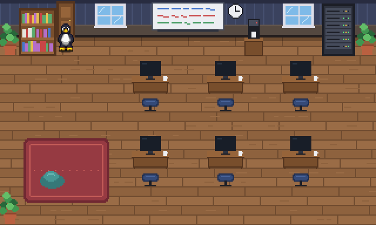

<div align="center">

# 🐧 Tux_Agent

**Your Claude Code agents, living as Tux penguins in a pixel-art office — right in your terminal.**

[English](README.md) · [Türkçe](README.tr.md)



</div>

Every Claude Code session gets its own Tux. When Claude reads files, Tux walks to the bookshelf.
When it edits code, Tux sits at a desk and code scrolls on the monitor. When it needs your
permission, Tux waves at you with a **!** over its head. When the work is done, Tux takes a break on the rug.

No browser, no editor extension: the office is drawn straight into your terminal, next to Claude Code.

## Features

- **Real pixels in the terminal** via the [Kitty graphics protocol](https://sw.kovidgoyal.net/kitty/graphics-protocol/) (Kitty, WezTerm, Ghostty), with a `▀` half-block fallback for any truecolor terminal
- **One Tux per session**: run several Claude Code sessions and each one gets its own penguin and desk
- **Live, not polled**: Claude Code [hooks](https://code.claude.com/docs/en/hooks) push events over a local Unix socket
- **Zero cost to Claude**: hooks run async, take ~20 ms, print nothing, and do nothing when Tux_Agent isn't running
- **Private**: only the event name, tool name, session id and folder name leave Claude Code, never file contents or commands, and only to a socket on your machine
- Pathfinding around the furniture, idle blinking, blinking server LEDs, English and Turkish status bar

## What Tux does

| Claude Code | Tux |
|---|---|
| Session starts / you send a prompt | walks to its desk and thinks |
| `Read`, `Grep`, `Glob` | reads a book at the bookshelf |
| `Edit`, `Write` | types at the desk, code scrolls on the monitor |
| `Bash` | tinkers with the server rack |
| `WebSearch`, `WebFetch` | looks out of the window |
| Permission request | stops and waves, with a **!** bubble |
| Turn finished (`Stop`) | sits down on the rug to rest |
| Session ends | walks out of the door |

## Requirements

- Linux (other Unix-likes will probably work but are untested)
- Python 3.10+
- [Claude Code](https://code.claude.com)
- For the best picture: **Kitty**, **WezTerm** or **Ghostty**. Other truecolor terminals use the lower-resolution half-block mode. tmux is not supported in Kitty mode yet.

## Install

```sh
# 1. install the program (uv or pipx)
uv tool install git+https://github.com/0anes0/Tux_Agent
# or: pipx install git+https://github.com/0anes0/Tux_Agent

# 2. add the hooks to ~/.claude/settings.json (a backup is made first)
tux-agent install
```

Or straight from a clone:

```sh
git clone https://github.com/0anes0/Tux_Agent && cd Tux_Agent
pip install --user pillow
python3 -m tux_agent install
```

## Usage

Open the office in one terminal window, and use Claude Code in another as usual:

```sh
tux-agent            # or: python3 -m tux_agent
```

In Kitty, a split right next to Claude Code works great: `ctrl+shift+enter` opens a new window
in the current tab. The picture scales to fill whatever space it gets.

While no session is running, a demo Tux walks around the office, and you can drive it:

| Key | Action |
|---|---|
| arrow keys | walk |
| `t` `r` `b` `w` | type · read · bash · window |
| `c` `s` `a` `l` | coffee · sit · ask (wave) · leave |
| `space` | toggle demo mode |
| `q` / `esc` | quit |

Options:

```
--backend {kitty,halfblock}   force a renderer (default: auto-detect)
--lang {en,tr}                status bar language (default: from $LANG)
--gif FILE                    render the demo to a GIF instead of the terminal
```

## How it works

```
 Claude Code ──hooks (async)──► tux_agent/hook.py ──Unix datagram──► tux-agent
                                                    $XDG_RUNTIME_DIR/        │
                                                    tux-agent.sock           ▼
                                               office + Tuxes drawn to an RGBA buffer
                                               → Kitty graphics protocol / half-blocks
```

- `tux_agent/hook.py`: tiny stdlib-only script that Claude Code runs on each event; trims the payload and sends it
- `tux_agent/events.py`: socket listener and event → activity mapping
- `tux_agent/agent.py`: Tux state machine, BFS pathfinding and animations
- `tux_agent/office.py`: the office, drawn entirely in code
- `tux_agent/backends.py`: Kitty (zlib-compressed, double-buffered, flicker-free) and half-block renderers

## Uninstall

```sh
tux-agent uninstall      # removes only Tux_Agent's hooks, leaves everything else alone
uv tool uninstall tux-agent
```

## Roadmap

- [ ] Little Tux chicks for subagents
- [ ] Different colours and accessories per Tux
- [ ] A layout for narrow, tall windows
- [ ] Office editor
- [ ] Sixel backend

## Credits & license

- Code: **GNU GPL v3**, see [`LICENSE`](LICENSE).
- Tux sprites: [*Tux – Kyrodian Legends Style*](https://opengameart.org/content/tux-kyrodian-legends-style)
  by **Kelvin Shadewing** (CC-BY-SA 4.0 / GPL 3.0). Tux was originally created by **Larry Ewing** with The GIMP.
  Details: [`tux_agent/assets/CREDITS.md`](tux_agent/assets/CREDITS.md).
- Inspired by [Pixel Agents](https://github.com/pablodelucca/pixel-agents), which does this inside VS Code.

Tux_Agent is a fan project and is not affiliated with Anthropic.
